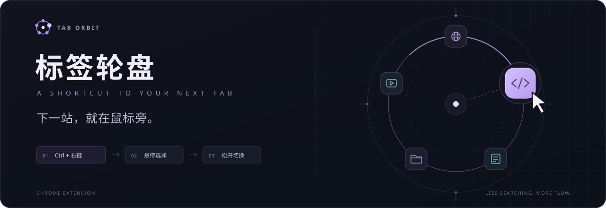
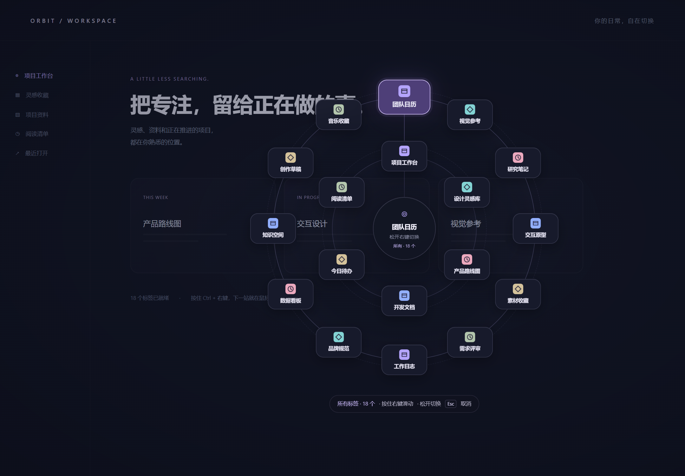
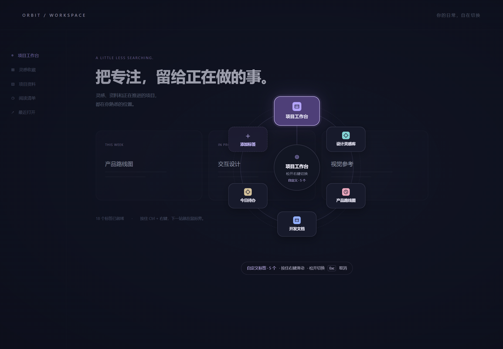
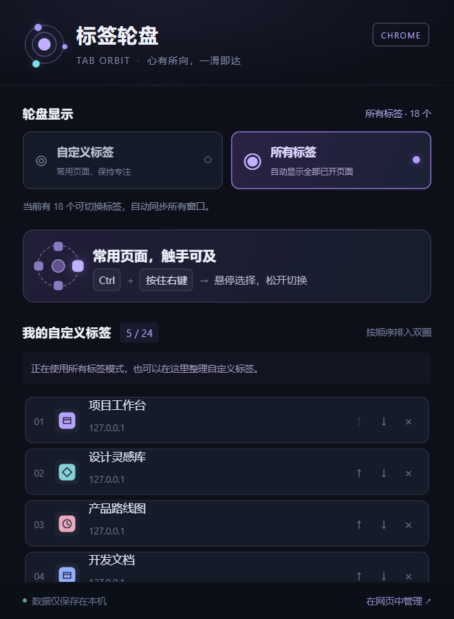

<div align="center">



<p>把已打开的页面，放到鼠标旁。</p>

<p>
  
  
  
</p>

<p>
  <a href="https://github.com/woxicaocao/tab-orbit/releases/latest"><strong>下载最新版</strong></a>
  &nbsp; · &nbsp;
  <a href="docs/INSTALLATION.md">安装指南</a>
  &nbsp; · &nbsp;
  <a href="docs/FAQ.md">常见问题</a>
  &nbsp; · &nbsp;
  <a href="docs/PRIVACY.md">隐私说明</a>
  &nbsp; · &nbsp;
  <a href="CHANGELOG.md">更新记录</a>
</p>

</div>

Tab Orbit 是一个 Chrome 标签切换插件。**按住 Ctrl + 鼠标右键，滑向目标，松开右键即可切换。** 悬停时卡片放大，目标在其他 Chrome 窗口中也能直接到达。

<p align="center">
  
  <sub>真实 Chrome 中的双圈轮盘。背景与标签名称使用本地演示数据。</sub>
</p>

## 常用的，或全部的

在工具栏插件面板中切换模式。**两种模式共用手势，切换时保留自定义收藏和顺序。**

| 模式 | 轮盘里显示什么 | 适合怎样使用 |
| --- | --- | --- |
| **自定义标签** | 手动添加的常用页面，最多 **24 个**；可以搜索、排序和移除收藏 | 把项目、文档和参考资料放在熟悉的位置 |
| **所有标签** | 自动同步所有 Chrome 窗口中可切换的已开页面，无需逐个添加 | 临时查找页面，多标签之间快速往返 |

**少时单圈，多时双圈。** 不超过 8 个位置时使用单圈；更多时最多两圈，内圈最多 8 个、外圈最多 16 个。自定义模式的「添加标签」入口也占一个位置；收藏满 24 个时隐藏入口，仍可从插件面板管理。

**超过 24 个，也能找到。** 所有标签模式每页最多显示 24 个；保持右键按住，滚动滚轮翻页。翻页后移动鼠标再选择，原地松手会安全取消。分页期间保持轮盘尺寸，末页不足 8 项时外圈可留空。

<table>
  <tr>
    <td width="68%" valign="top">
      
      <p align="center"><sub>少量常用标签，单圈即可到达。</sub></p>
    </td>
    <td width="32%" valign="top">
      
      <p align="center"><sub>切换模式，收藏依然保留。</sub></p>
    </td>
  </tr>
</table>

## 三步切换

| 01 · 呼出 | 02 · 选择 | 03 · 到达 |
| --- | --- | --- |
| 在普通网页中，先按住 **Ctrl**，再按住**鼠标右键** | 保持右键按住，滑到目标卡片，看到它放大 | **松开右键**，切换到对应标签；跨窗口时目标窗口会置前 |

想取消时，移回轮盘圆心再松手，或按 **Esc**。只按下并松开、不移动鼠标，不会切换。普通右键保留原有行为。

## 安装到 Chrome

1. 前往 [Releases 下载最新版](https://github.com/woxicaocao/tab-orbit/releases/latest)，选择发布附件中的**扩展 ZIP**，完整解压到一个准备长期保留的文件夹。
2. 在 Chrome 地址栏输入 `chrome://extensions`，打开「开发者模式」，点击「加载已解压的扩展程序」。选择**直接包含 `manifest.json` 的那一层文件夹**，不要选择 ZIP 文件。
3. 固定工具栏中的「标签轮盘 Tab Orbit」，然后**刷新安装前已打开的网页**。第一次可以选择「所有标签」模式直接体验；自定义模式需先添加标签。

安装不需要 Node.js，也不需要运行命令。图解与完整步骤见 [安装指南](docs/INSTALLATION.md)。当前使用本地加载方式，不是 Chrome 商店一键安装。

**升级时保留原加载目录，不要卸载。** 将新版本文件复制到原目录，在扩展管理页点击「重新加载」，再刷新网页；原自定义收藏会继续保留。若出现 `Unknown operation` 或「未知的轮盘操作」，请按 [更新排错步骤](docs/FAQ.md#更新后提示未知的轮盘操作怎么办)检查旧后台是否仍在运行。

## 本机数据，清楚的边界

收藏与模式保存在当前 Chrome 用户配置的本地存储中。图标从 Chrome 本地图标缓存读取；插件没有自建服务器、统计 SDK 或远程上传接口。网页内的轮盘使用封闭 Shadow DOM，避免页面脚本通过普通 DOM 接口读取轮盘中的其他标签信息。详细数据项目与权限用途见 [隐私说明](docs/PRIVACY.md)。

- **在普通网页中呼出。** 设置页、新标签页、Chrome 网上应用店和内置 PDF 查看器等受保护页面无法显示轮盘，但可切换的内部页面仍可作为目标。
- **iframe 与原生视频全屏暂有限制。** 在网页主体区域操作；本地文件和无痕窗口需按需在扩展详情中允许。
- **收藏不会代替你打开页面。** 已关闭的自定义标签保留位置并显示不可用；相同完整网址重新打开后可恢复。[更多使用说明 →](docs/FAQ.md)

当前主要验收环境为 **Windows + Chrome for Testing 155**；其他系统与浏览器尚未全面验证。

## 开发与验证

原生 JavaScript / CSS / HTML，Manifest V3，无生产依赖、无需构建。下载或克隆仓库后可直接加载含 `manifest.json` 的目录。

```bash
git clone https://github.com/woxicaocao/tab-orbit.git
cd tab-orbit
npm test
```

浏览器集成检查运行 `npm run test:browser`，额外需要配置 Playwright 与 Chrome for Testing，详见 [测试说明](README_TESTS.md)。

**1.1.0 验收记录（2026-10-18）：** Node.js 后台测试 **31 / 31**、真实 Chrome 集成检查 **19 / 19** 通过。浏览器检查使用独立配置和本地测试网页，覆盖双圈命中、跨窗口、24 个收藏、分页及尾页可达、取消与模式切换；工具栏原生弹出气泡和系统层面的行为仍需人工验收。这是该版本的测试记录，不表示所有浏览器环境都已验证。

---

<p align="center">
  <a href="https://github.com/woxicaocao/tab-orbit/releases/latest">下载 Tab Orbit</a>
  &nbsp; · &nbsp;
  <a href="docs/INSTALLATION.md">开始安装</a>
  &nbsp; · &nbsp;
  <a href="https://github.com/woxicaocao/tab-orbit/issues">反馈问题</a>
</p>
