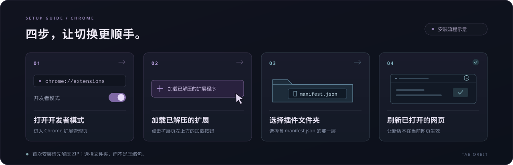

# 安装与更新

[← 返回项目首页](../README.md) · [下载最新版](https://github.com/woxicaocao/tab-orbit/releases/latest) · [常见问题](FAQ.md)

Tab Orbit 目前通过 Chrome 的「加载已解压的扩展程序」安装。**先下载 ZIP 并解压，再选择包含 `manifest.json` 的文件夹。** 不需要 Node.js、命令行或 npm。

当前主要验证环境为 Windows + Chrome for Testing 155。扩展清单声明最低 Chrome 版本为 102，其他版本和系统尚未全面验收。

## 1. 下载并解压

打开 [最新发布页](https://github.com/woxicaocao/tab-orbit/releases/latest)，在 **Assets / 发布附件** 中下载扩展 ZIP。

完整解压到一个准备长期保留的位置。Chrome 会继续从这个文件夹读取扩展，所以安装后请保留目录及其文件，避免随意移动。

找到直接包含以下文件的那一层目录，下一步需要选择它：

```text
扩展文件夹/
├── manifest.json
├── background.js
├── content.js
├── popup.html
├── popup.js
├── popup.css
└── icons/
```

如果解压后有多层同名文件夹，请继续进入，直到看到 `manifest.json`。不要把 ZIP 文件、最外层空壳目录或 `docs` 目录当作扩展加载。

如果下载的是 GitHub 自动生成的 Source code ZIP，也需要完整解压，并找到其中直接包含 `manifest.json` 的目录；首次安装优先使用发布附件中的扩展 ZIP。

## 2. 加载到 Chrome

1. 在 Chrome 地址栏输入 `chrome://extensions` 并回车。
2. 打开页面右上角的**开发者模式**。
3. 点击**加载已解压的扩展程序**。
4. 选择上一步直接包含 `manifest.json` 的文件夹。
5. 确认出现「标签轮盘 Tab Orbit」卡片，版本为 **1.1.2**，且扩展开关已打开。



*上图为流程示意，不是 Chrome 原生界面截图。*

## 3. 刷新网页，开始使用

在工具栏的拼图菜单中找到「标签轮盘 Tab Orbit」，点击图钉固定。**刷新安装前就已打开的网页**，让新安装的内容脚本生效。

点击插件图标，选择一种模式：

| 模式 | 第一次要做什么 |
| --- | --- |
| **所有标签** | 直接选择该模式，即可使用已打开的可切换标签 |
| **自定义标签** | 在下方搜索已打开页面并点「添加」，最多保存 24 个收藏；轮盘只显示其中仍打开的页面 |

回到一个普通 `https://` 或 `http://` 网页，在网页主体区域先按住 **Ctrl**，再按住**右键**。把鼠标滑到卡片上，看到它放大后，**松开右键**切换。

所有标签按当前窗口优先、各窗口标签栏从左到右排列；自定义标签保持你在面板中安排的顺序。单圈从 12 点方向起顺时针排列；双圈先读内圈前 8 个，再读外圈第 9–24 个，固定槽位不足时留空。

所有标签超过 24 个时，保持右键按住并滚动滚轮翻页，序号从 25 继续。翻页后先移动鼠标再选择；想取消时移回圆心松手，或按 `Esc`。「添加标签」入口占位置但不编号。

关闭页面后，轮盘会自动移除对应卡片；自定义收藏仍保存在管理面板，重新打开同一完整网址后按原顺序恢复。所有标签模式会自动加入新开页面。轮盘展开期间若列表更新，会清空当前选中状态，请重新移动鼠标再选择。

## 从旧版本更新，保留收藏

更新请继续使用**同一个 Chrome 用户配置、同一个原加载目录和同一张扩展卡片**。不要为了更新先卸载，也不要把每个版本都加载成一个新扩展。

1. 从 [Releases](https://github.com/woxicaocao/tab-orbit/releases/latest) 下载并解压新版本。
2. 如需备份，可先复制原扩展目录留存。然后将新版本内容复制到**原来加载的扩展目录**，覆盖相应版本文件，保持原目录路径。
3. 打开 `chrome://extensions`，在已有「标签轮盘 Tab Orbit」卡片上点击**重新加载**。
4. 确认扩展卡片显示新版本，再**刷新已经打开的网页**。

自定义收藏、顺序和模式保存在 Chrome 的扩展本地存储中，不在安装文件夹里。保留原扩展并重新加载时，这些数据会继续使用；从旧版升级到 1.1.2 也会保留原收藏和人工顺序。关闭页面后从轮盘隐藏，不代表删除已保存的收藏。

如果升级后出现 `Unknown operation`、「未知的轮盘操作」或新旧界面混用，先按 [常见问题中的更新排错](FAQ.md#更新后提示未知的轮盘操作怎么办)处理，通常无需卸载。

## 特殊页面与权限

- **设置、新标签页、Chrome 网上应用店、内置 PDF 查看器：**这些受保护页面不能呼出轮盘。请从普通网页呼出，再切换到可用的目标标签。
- **本地文件：**若要在 `file://` 页面使用，在扩展「详情」里打开「允许访问文件网址」，随后刷新该页面。
- **无痕窗口：**默认未启用。需要使用时，在扩展「详情」中手动允许；启用前请阅读 [隐私说明](PRIVACY.md#无痕窗口)。
- **网站内嵌 iframe、视频元素自身的原生全屏：**目前无法在这些区域可靠显示轮盘，请移到网页主体区域操作，或退出原生视频全屏。

如果 Chrome 由组织统一管理，开发者模式或本地扩展加载可能受管理员策略限制。

更多排查方法见 [常见问题](FAQ.md)。
